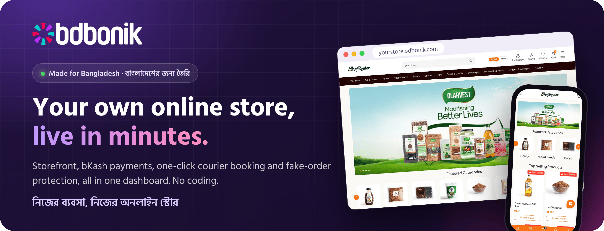
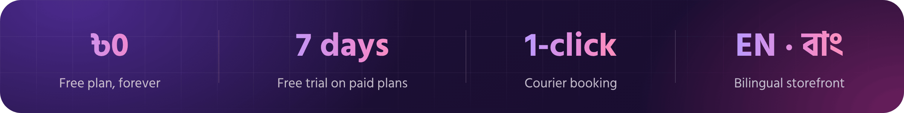
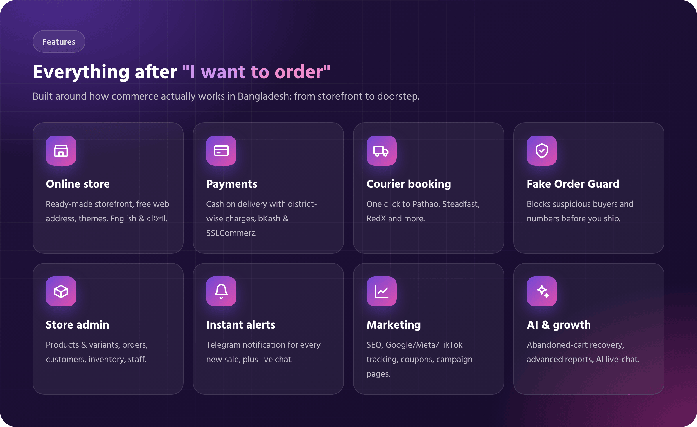
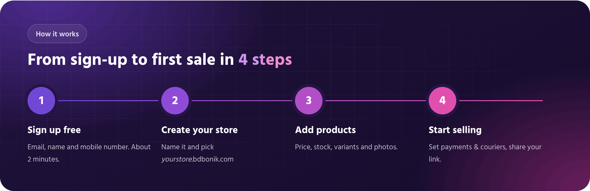
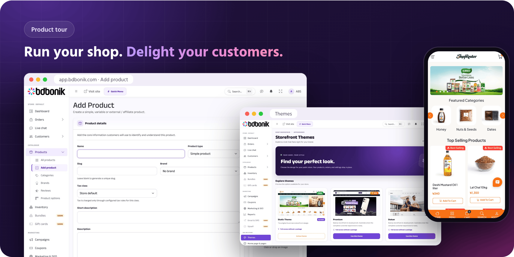
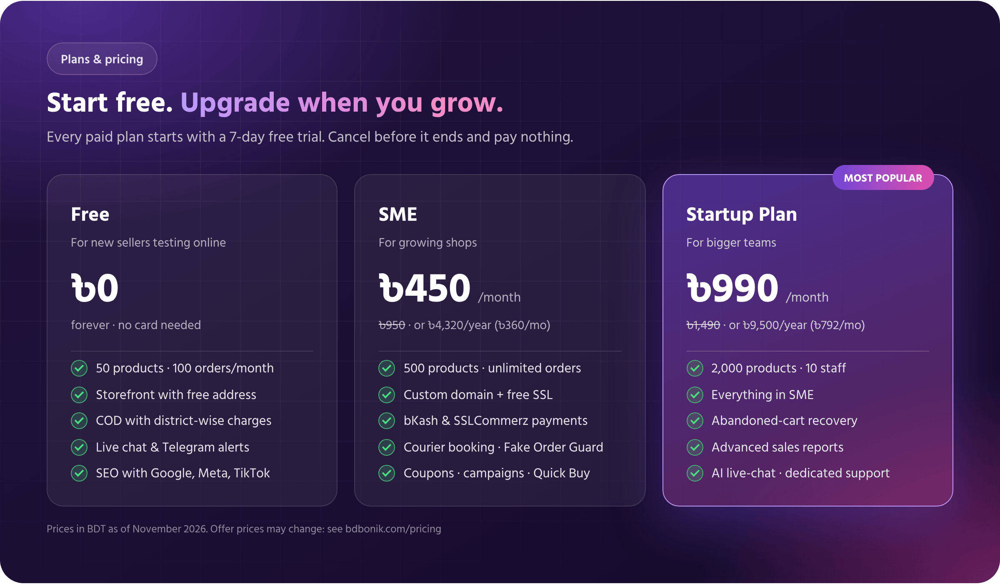
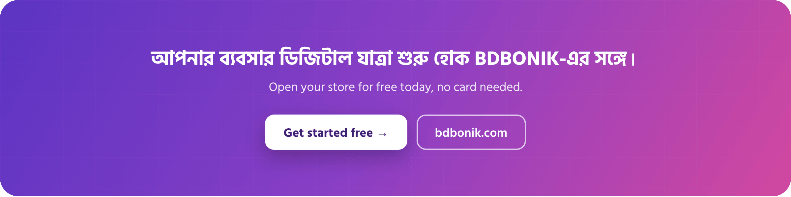

 

  

 

<table>
<tr>
<td width="50%" valign="top">

### 🇬🇧 About

**BDBONIK** is an e-commerce SaaS platform built for businesses in Bangladesh. Facebook sellers, retailers, wholesalers and new entrepreneurs can open a professional online store in minutes, with no coding and no developer, and run the full **order-to-delivery journey** from one dashboard.

</td>
<td width="50%" valign="top">

### 🇧🇩 পরিচিতি

**BDBONIK** বাংলাদেশের ব্যবসার জন্য তৈরি ই-কমার্স প্ল্যাটফর্ম। কোনো প্রোগ্রামিং জ্ঞান ছাড়াই কয়েক মিনিটে নিজের অনলাইন স্টোর খুলুন, আর এক জায়গা থেকে পরিচালনা করুন পণ্য, অর্ডার, পেমেন্ট, কুরিয়ার, কাস্টমার ও স্টক।

</td>
</tr>
</table>

<b>📋 See the full feature list</b>

 

| Area | What you get | Plan |
|---|---|:---:|
| 🛍️ **Storefront** | Ready-made store with free `yourstore.bdbonik.com` address, themes, English & বাংলা | All |
| 🌐 **Custom domain** | Your own domain with free SSL | SME+ |
| 📦 **Catalogue** | Simple, variable (size, colour) and affiliate products · brands · categories · stock · images | All |
| 🧾 **Orders & customers** | Order status tracking, customer list, inventory (stock in / out / low stock), staff accounts | All |
| 💵 **Cash on delivery** | District-wise delivery charges, zones inside and outside Dhaka | All |
| 💳 **Online payments** | bKash & SSLCommerz gateway, Quick Buy one-tap checkout | SME+ |
| 🚚 **Couriers** | One-click booking with Pathao, Steadfast, RedX and more | SME+ |
| 🛡️ **Fake Order Guard** | Blocks suspicious buyers and phone numbers before you ship | SME+ |
| 🔔 **Alerts & chat** | Telegram alert for every sale, live chat with shoppers | All |
| 📈 **Marketing** | SEO, Google / Meta / TikTok tracking, email templates | All |
| 🎟️ **Promotions** | Coupons & discount codes, campaign landing pages | SME+ |
| 🛒 **Recovery & reports** | Abandoned-cart recovery, advanced sales reports | Startup |
| 🤖 **AI** | Smart live-chat assistant, unlimited AI requests with your own API key | Startup |

 

 

 

<b>🗓️ Billing cycles & full plan comparison</b>

 

| Billing | SME | per month | Startup Plan | per month |
|---|---:|---:|---:|---:|
| Monthly | ৳450 | ৳450 | ৳990 | ৳990 |
| 3 months | ৳1,280 | ৳427 | ৳2,820 | ৳940 |
| 6 months | ৳2,430 | ৳405 | ৳5,350 | ৳892 |
| **Yearly** | **৳4,320** | **৳360** | **৳9,500** | **৳792** |

💰 **Yearly vs. monthly:** SME saves **৳1,080/year** · Startup Plan saves **৳2,380/year**

| | Free | SME | Startup Plan |
|---|:---:|:---:|:---:|
| Products | 50 | 500 | 2,000 |
| Orders / month | 100 | Unlimited | Unlimited |
| Staff | 1 | 5 | 10 |
| Themes (premium) | 1 | 3 (2) | 3 (2) |
| Online store · admin · alerts · SEO | ✅ | ✅ | ✅ |
| Custom domain · payments gateway | — | ✅ | ✅ |
| Courier API · Fake Order Guard | — | ✅ | ✅ |
| Coupons · campaign pages · Quick Buy | — | ✅ | ✅ |
| Abandoned carts · advanced reports | — | — | ✅ |
| Live Chat AI (own API key) | — | — | ✅ |
| Support | — | Priority | Dedicated |

🎁 7-day free trial on every paid plan · 💳 Pay with bKash, card (SSLCommerz), Nagad, Rocket or bank transfer

 

## 🎬 Learn

<table>
<tr>
<td width="50%" align="center">

 <b>Full Bangla tutorial</b> Sign-up → store → products → plans
</td>
<td width="50%" align="center">

 <b>Package comparison</b> Free vs SME vs Startup Plan
</td>
</tr>
</table>

| 📚 Guides | |
|---|---|
| ✅ [Launch-your-store checklist](https://bdbonik.com/blog/launch-your-store-checklist) | 🌐 [Connect your own domain](https://bdbonik.com/blog/connect-your-own-domain) |
| 🔁 [Automatic renewal & online payments](https://bdbonik.com/blog/automatic-renewal-and-online-payments) | 🧭 [Getting started](https://bdbonik.com/getting-started) · [How it works](https://bdbonik.com/how-it-works) |
| 🆘 [Help centre](https://bdbonik.com/help) · [FAQ](https://bdbonik.com/faq) | ✍️ [Blog](https://bdbonik.com/blog) · [Medium](MEDIUM_LINK) |

 

 

📧 [support@bdbonik.com](mailto:support@bdbonik.com) · 🌐 [bdbonik.com](https://bdbonik.com) · [About](https://bdbonik.com/about) · [Contact](https://bdbonik.com/contact)

[Terms](https://bdbonik.com/terms-of-service) · [Privacy](https://bdbonik.com/privacy-policy) · [Refund policy](https://bdbonik.com/refund-policy) · Found a security issue? Email support@bdbonik.com, please don't open a public issue.

Prices in BDT as of November 2026 · see <a href="https://bdbonik.com/pricing">bdbonik.com/pricing</a> for the latest

